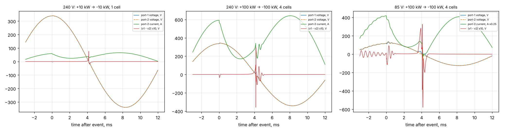
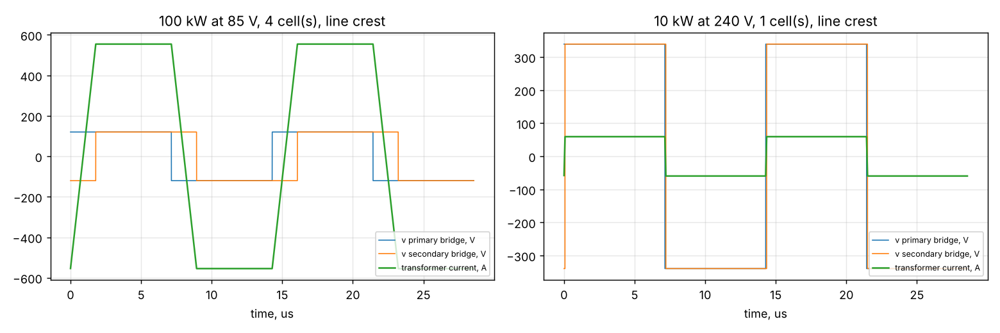

# 10 kW / 100 kW-peak isolated bidirectional AC-AC dual active bridge

Preliminary design, revision A. All numbers come from `tools/dab_design.py` and
`tools/dab_sim.py`; rerun them to regenerate the tables and plots. Nothing here
has been built or measured. Section 11 lists what is estimated and what must be
checked before hardware is committed.

## 1. Requirement and how it was read

| Item | Value |
|---|---|
| Port voltage | 85-285 Vrms on both ports, output equals input (1:1) |
| Power | 10 kW continuous, 100 kW for 10 s |
| Direction | Bidirectional, may reverse at any instant with no warning |
| Switches | SiC or GaN |
| Magnetics | Ferrite transformer, optimised |
| Switching frequency | 50 kHz minimum, to be evaluated |
| Compliance | UL safety, FCC emissions |
| Telemetry | Voltage, current, temperature, power, remotely readable |

Assumptions made where the request was silent. Each one changes the design, so
please correct any that are wrong:

1. **Single phase, 50/60 Hz.** A three-phase unit would be three of these at one
   third the power each.
2. **100 kW is available at any voltage in the range, including 85 V.** That is
   1176 A rms (1663 A crest) and it sets the semiconductor count. See section 10.
3. **Galvanic isolation is required** (otherwise no transformer is needed), to
   reinforced-insulation level.
4. **The 10 s peak repeats no more often than once every 5 minutes.**
5. **"Power" means real power at near-unity power factor.** Reactive current is
   carried, with the limits in section 7.

## 2. Architecture

A dual active bridge is a DC-DC stage, so an AC-AC unit needs something around
it. Three options were considered:

| Option | Verdict |
|---|---|
| Rectifier + DC link + DAB + inverter (three stages) | Rejected. Needs about 13 mF of DC-link capacitance per side to absorb the 100 kW double-line-frequency ripple, plus boost inductors rated 1663 A peak, and three conversion stages in series. |
| Matrix DAB with four-quadrant switches | Rejected. Same number of devices in the current path as the chosen option but needs four-step commutation and non-standard gate drive. |
| **AC-link DAB between two line-frequency unfolders** | **Chosen.** No electrolytics, no line-frequency energy storage, standard half-bridge modules, inherently symmetric. |

```
 Port 1          unfolder 1      link 1        4 x DAB cells         link 2     unfolder 2        Port 2
 85-285 V  EMI   (60 Hz, SiC)   |v|, 80 uF   HB - 1:1 xfmr - HB    |v|, 80 uF  (60 Hz, SiC)  EMI  85-285 V
 o------[filter]--[ H-bridge ]----+--------[ cell 1 ... cell 4 ]--------+----[ H-bridge ]--[filter]------o
                                  |          (interleaved,              |
                                 ===          shed at light load)      ===
```

Each unfolder is a full bridge switched at line frequency. It presents the
rectified line voltage |v(t)| to a small film-capacitor link. The DAB cells run
between the two links at unity conversion ratio at every instant, which is the
best operating point a DAB has: minimum circulating current and soft switching
on both bridges.

Two details matter and both came out of simulation:

* **The link capacitors sit on the DC side of the unfolders, and both unfolders
  take one shared polarity command.** A DAB cannot pass current when its link
  voltages are zero. With the capacitors on the AC side, any current that is out
  of phase with the voltage has nowhere to go at the zero crossing and the
  filter-inductor energy drives the capacitors to several hundred volts. With
  the arrangement above the link never has to reach zero: the unfolders flip
  with a few volts still on the link and the current carries straight through.
* **The control law is symmetric** (section 7). The converter never needs to
  know which port is the source.

## 3. Why the low-line peak sets everything

DAB power per cell is `P = V1*V2*D*(1-D) / (2*f*L)`, with D the phase shift as a
fraction of a half period. At 85 V the link crest is only 120 V and the
instantaneous power crest is 200 kW, so the series inductance has to be tiny:

    f * L_total  <=  7.2e-3 ohm      (D = 0.25 at 100 kW, 85 V, leaving 33 % headroom)

That is 103 nH at 70 kHz for the whole converter. It is not buildable as one
transformer, so the power stage is split into **4 parallel cells of 387 nH
each**, with the transformer leakage used as the DAB inductor (no separate
inductor). Consequences that drive the rest of the design:

* Higher frequency needs proportionally lower inductance. The bus and
  termination inductance (estimated 60 nH) does not shrink, so frequency is
  capped by construction, not by the ferrite.
* At 10 kW the same inductance makes the phase shift very small (48-280 ns).
  Timing resolution, not loss, becomes the light-load concern.
* Transformer flux is set by voltage, not current. A 10x overload therefore
  costs copper heating only, and the transformer can be sized for 10 kW
  thermally with an adiabatic check for the 10 s peak.

## 4. Semiconductors

**1200 V SiC MOSFET half-bridge modules throughout.** The link has no bulk
capacitor, so a line surge reaches the switches clamped only by the MOVs (about
800-850 V for 320 Vac-class parts). That rules out 650 V devices. GaN was
rejected for three reasons: 650 V rating with no avalanche capability, no
commercially available parts at 350 A rms per switch, and no benefit at 70 kHz
where switching loss is already minor.

Cell-count study at the worst corner (100 kW, 85 V), 50 kHz:

| Module class | Cells | HF modules | Loss at 85 V | Loss at 240 V | Peak Tj |
|---|---|---|---|---|---|
| 1.33 mohm (62 mm, CAB760M12HM3 class) | 3 | 12 | 13.1 kW | 1.44 kW | 107 C |
| **1.33 mohm** | **4** | **16** | **11.4 kW** | **1.32 kW** | **106 C** |
| 1.33 mohm | 6 | 24 | 9.9 kW | 1.24 kW | 105 C |
| 2.6 mohm (CAB450M12XM3 class) | 6 | 24 | 12.6 kW | 1.39 kW | 107 C |
| 2.6 mohm | 10 | 40 | 9.6 kW | 1.36 kW | 105 C |

Four cells of the 1.33 mohm class is the knee: fewer cells pushes the per-cell
inductance to 400 nH and below at 50 kHz, more cells buys little. Selected
complement:

| Function | Modules | Notes |
|---|---|---|
| HF bridges | 16 (4 cells x 2 bridges x 2 legs) | 358 A rms per cell at the peak corner |
| Unfolders | 8 (2 ports x 2 legs x 2 in parallel) | Line-frequency switching, synchronous conduction, 832 A rms per leg |

Peak junction temperature is about 106 C against a 175 C rating, so there is
real thermal margin. A third parallel unfolder module per leg would cut the
85 V peak loss by about 1.8 kW if that corner's efficiency matters.

Soft switching: the transformer is gapped to 30 uH magnetising inductance so
that about 48 A of magnetising current is available at the 403 V crest. That
gives zero-voltage turn-on over 99-100 % of the line cycle at every load,
independent of the load current. Dead time 200 ns.

## 5. Switching frequency evaluation

Four cells, 1.33 mohm modules, transformer re-optimised at each frequency:

| f | L per cell | Transformer (per cell) | Mass per cell | Eff. 10 kW, 240 V | Eff. 10 kW, 85 V | Loss 100 kW, 85 V | Phase shift at 10 kW, 240 V |
|---|---|---|---|---|---|---|---|
| 50 kHz | 542 nH | 2x E100/60/28, 7 turns | 2.88 kg | 98.97 % | 97.95 % | 11.39 kW | 95 ns |
| **70 kHz** | **387 nH** | **2x E100/60/28, 6 turns** | **2.87 kg** | **98.87 %** | **97.75 %** | **11.25 kW** | **68 ns** |
| 100 kHz | 271 nH | 2x E100/60/28, 5 turns | 2.49 kg | 98.73 % | 97.47 % | 11.56 kW | 47 ns |
| 140 kHz | 194 nH | 2x E100/60/28, 4 turns | 2.35 kg | 98.51 % | 97.11 % | 11.74 kW | 34 ns |
| 200 kHz | 135 nH | 2x E100/60/28, 4 turns | 2.33 kg | 98.23 % | 96.52 % | 12.25 kW | 24 ns |
| 300 kHz | 90 nH | 2x E100/60/28, 3 turns | 2.19 kg | 97.83 % | 95.84 % | 12.93 kW | 16 ns |


Findings:

* **Raising frequency buys almost nothing here.** The transformer is sized by
  current and by the leakage target, not by flux, so mass falls only 24 % from
  50 to 300 kHz while efficiency falls by more than a point. Gate-drive loss on
  these large modules (29 W per active cell at 70 kHz) and turn-off loss both
  scale with frequency.
* Above about 140 kHz the required inductance falls under 200 nH per cell.
  With 60 nH of unavoidable stray that leaves no tolerance, and the 10 kW phase
  shift drops to the order of gate-driver skew.
* 50 and 70 kHz are within 0.2 points of each other.

**Selected: 70 kHz.** It keeps margin above the 50 kHz floor, puts both the
fundamental and the 140 kHz link ripple below the 150 kHz start of the FCC
conducted band, and shortens the control delay by 30 % relative to 50 kHz,
which directly reduces the link capacitance needed for stability. The cost is
about 0.1 points of efficiency.

## 6. Transformer (one per cell, four total)

Found by exhaustive search over 6 core shapes, 1-4 stacked sets, 1-12 turns,
interleaving, three litz strand sizes and copper build. The objective is mean
continuous loss across the voltage range plus 4 W per kg, subject to a 55 K
rise, a 30 K adiabatic rise in the 10 s peak, flux below 280 mT at +10 % line,
and the leakage inductance landing on target with at least a 1 mm reinforced
barrier.

| Parameter | Value |
|---|---|
| Core | 2 stacked sets E100/60/28, MnZn power ferrite (N87 data used; N97/3C97 would be 15-25 % lower loss) |
| Effective area / volume | 1476 mm^2 / 404 cm^3 |
| Turns | 6 : 6 |
| Winding arrangement | P/2 - S - P/2 (two primary-secondary interfaces) |
| Conductor | Litz, 36.7 mm^2 copper per turn, 0.05 mm strands (about 18 700; built as parallel bundles) |
| Primary-secondary barrier | 3.4 mm per interface, sets the leakage |
| Leakage inductance | 327 nH (plus 60 nH stray = 387 nH) |
| Magnetising inductance | 30 uH, total core gap about 2.2 mm |
| Peak flux | 163 mT at 285 V, 179 mT at +10 % |
| Mass | 2.87 kg (1.96 kg ferrite, 0.91 kg copper) |
| Continuous loss, one cell carrying 10 kW | 35 W at 85 V, 22 W at 120-208 V, 25 W at 240 V, 33 W at 285 V |
| Steady temperature rise | 24 K (forced air, 22 W/m^2K) |
| Peak-corner copper loss | 245 W per transformer, 7 K adiabatic rise in 10 s |
| AC resistance factor | 1.26 at 10 kW / 85 V, 1.09 at the peak |

Core loss benefits from the AC link: flux follows the line envelope, so the
loss averaged over a line cycle is about 45 % of the value at the crest.

Construction notes. The barrier doubles as the leakage-setting spacer, so its
thickness needs a +/-0.2 mm tolerance; plan one prototype iteration to trim
it. Keep the winding 3 mm or more clear of the core gap, or split the gap, to
limit fringing loss. Use an insulation system recognised to UL 1446 class F or
better, with two embedded temperature sensors per transformer.

## 7. Control and unannounced power reversal

Each cell uses plain single-phase-shift modulation. Because the conversion
ratio is always 1, more elaborate modulation schemes offer nothing.

**Virtual-transformer law.** Twice per switching period the controller samples
both link voltages and both port currents and sets

    i_ref = (i_port1 + i_port2) / 2  +  Kp * (v_link1 - v_link2)  +  Ki * integral(v_link1 - v_link2)
    D     = solve  D * (1 - |D|) = i_ref * 2 * f * L / (n_active * v_mean)

D is signed. There is no mode, no direction flag and no source/load
designation. If the far side starts pushing power back, the voltage error and
the current feed-forward change sign and D follows through zero within one
sample (7 us). A DAB on its own behaves as a gyrator, which resonates with
small link capacitors; averaging the two port currents in the feed-forward
cancels that and makes the pair of links behave like one capacitor behind an
ideal transformer.

Simulated with one sample of computation delay, 80 uF per link, both ports
modelled as sources behind damped filter inductance, and the far-side source
jumping at the line crest so that steady-state power reverses:

| Event | Port mismatch before | Worst mismatch after |
|---|---|---|
| 240 V, +10 kW to -10 kW, 1 cell | 0.06 V | 7.6 V (2.2 % of crest) |
| 85 V, +10 kW to -10 kW, 2 cells | 0.19 V | 16.5 V (13.8 %) |
| 240 V, +100 kW to -100 kW, 4 cells | 0.6 V | 35.9 V (10.6 %) |
| 85 V, +100 kW to -100 kW, 4 cells | 5.3 V | 57.9 V (48 %) |



The reversal itself disturbs the voltage by only a few volts. The worst
mismatch in every case is a sub-millisecond notch at the following zero
crossing, where current that is out of phase with the voltage has to be carried
through the unfolder flip. The 85 V / 100 kW case is stable but coarse and
needs a source impedance of 8 uH or less per port; treat that corner as
"survives and keeps transferring power", not as clean power quality.

**Link capacitance: 80 uF per side** (20 uF of film per cell). 40 uF was
unstable at 100 kW below about 150 V. The price is leading reactive current
drawn by each port even at no load: 8.6 A (2.4 kvar) at 285 V, 7.2 A at 240 V,
3.6 A at 120 V. At 10 kW and 285 V the source sees a power factor of about
0.90. This is a direct consequence of the 100 kW low-line requirement.

Other control functions:

* **Cell shedding.** One cell runs at 10 kW for 208 V and above, two below.
  All four are enabled when demand exceeds a threshold; enabling takes one
  switching period because the links are common.
* **Interleaving.** Active cells are phase-staggered so link ripple is at
  2 x n x 70 kHz.
* **Current limit.** `i_ref` is clamped. Beyond the clamp the unit becomes a
  current source and lets the port voltages separate, which is the correct
  response to a far-side fault or sag.
* **Flux balance.** Magnetising current is sensed per cell and volt-second
  imbalance trimmed; the 2.2 mm gap gives tolerance to residual offset.
* **Hardware.** FPGA or a C2000-class MCU with 150 ps high-resolution phase
  control. Static gate-driver skew is absorbed by the integral term.

## 8. Predicted performance at 70 kHz

| Vrms | 10 kW: cells / loss / efficiency | 2.5 kW efficiency | 100 kW: loss / efficiency | Peak Tj |
|---|---|---|---|---|
| 85 | 2 / 225 W / 97.75 % | 96.85 % | 11.25 kW / 88.75 % | 106 C |
| 120 | 2 / 167 W / 98.33 % | 97.02 % | 4.89 kW / 95.11 % | 84 C |
| 208 | 1 / 116 W / 98.84 % | 96.82 % | 1.71 kW / 98.29 % | 71 C |
| 240 | 1 / 113 W / 98.87 % | 96.63 % | 1.37 kW / 98.63 % | 69 C |
| 285 | 1 / 115 W / 98.85 % | 96.28 % | 1.09 kW / 98.91 % | 68 C |


At the 85 V peak the loss splits as unfolders 5.3 kW, HF bridge conduction
3.9 kW, transformer copper 1.0 kW, switching 0.5 kW, bus and filter 0.4 kW.
The 10 s event deposits about 113 kJ. A 14 kg aluminium heatsink absorbs the
semiconductor share with an 8 K rise, so the cooling system only needs to be
sized for the continuous loss (under 250 W) plus recovery between peaks.
Light-load efficiency is held down by about 65 W of fixed loss (gate drive and
auxiliaries).

The closed-form waveform model was checked against a time-stepped switched
simulation: 100.2 kW simulated for 100 kW set, 358.2 A against 358.0 A rms.



## 9. Compliance and instrumentation

**Safety (UL).** The governing standard depends on end use and should be fixed
with the NRTL at the start: UL 1741 (with IEEE 1547) if either port is a
utility interconnection with generation or storage behind it, otherwise UL 1012
or UL 508-family industrial equipment standards. Design provisions common to
all of them:

* Reinforced insulation port to port: transformer barrier, 8 mm creepage and
  clearance across the isolation boundary on PCBs and busbars, reinforced-rated
  gate drivers, sensors and communication isolators.
* UL 1446 insulation system in the transformer, UL 94 V-0 plastics, recognised
  film capacitors (X-class where across the line), listed fuses and contactors
  on both ports.
* Surge: MOVs with thermal disconnect on each port, plus an active clamp on
  each link, coordinated with the 1200 V device rating.
* Independent hardware protection that does not rely on firmware: desaturation
  detection on every switch (under 2 us), link over-voltage comparators,
  over-temperature cut-outs, and a watchdog that opens the port contactors.
* Because either port can be live, both are treated as sources: discharge of
  the links below 60 V within the required time after disconnection, and
  warning labels on both sides.

**Emissions (FCC Part 15 Subpart B, Class A assumed for industrial use;
Class B if residential).** Two-stage common-mode and differential-mode filter
on each port, with damping, since the damping is also needed for control
stability. Low-inductance laminated bus, a grounded electrostatic shield
between transformer windings to cut common-mode current, controlled gate
resistance, and a fully shielded enclosure. The 1663 A peak sets the filter
inductor size; use nanocrystalline common-mode cores and keep differential
inductance at or below 8 uH per port.

**Instrumentation.**

| Quantity | Where | Method |
|---|---|---|
| Voltage | Both ports, both links | Reinforced-isolated delta-sigma modulators |
| Current | Both ports (2 kA class), each cell's transformer primary | Closed-loop Hall or fluxgate on ports, Rogowski or CT per cell |
| Temperature | Every module NTC, 2 per transformer, heatsink, link capacitors, inlet and outlet air | NTC / PT1000 |
| Power | Per port | Computed: P, Q, S, power factor, direction, energy in each direction |
| State | Active cells, phase shift, limits, faults, event log with pre-trigger waveform capture | Controller |

Telemetry is published over isolated CAN FD and Ethernet (Modbus TCP, or MQTT
over TLS) at 10 Hz, with faults pushed immediately. Remote access is read-only
by default; setpoint and firmware changes require authentication. The CAN side
can share a bus with the battery-management code already in this repository.

## 10. What the 85 V / 100 kW corner costs

That single corner sets 24 large SiC modules, the 80 uF links and their
reactive current, and the 1663 A filter. If the 100 kW peak were only required
above roughly 200 V, with a constant-current limit below, peak current falls
from 1176 A to about 500 A rms. By estimate (not modelled), that is two cells
and single unfolder modules, about half the semiconductor count, and 40 uF
links. Worth confirming before committing.

A related alternative: operating the same hardware as a series-resonant
converter at fixed frequency makes it an open-loop "DC transformer" whose
output follows its input without fast control. It gives up the current
limiting and power-flow control that a DAB provides, so it was not adopted,
but it is the fallback if the low-line dynamics in section 7 prove too coarse.

## 11. Open items

1. **Device data.** On-resistance (1.33 mohm typ, 1.73 max) and gate charge are
   from vendor listings. Thermal resistance, output charge, temperature
   coefficient and fall time are estimates; the vendor's datasheet site was not
   reachable from the design environment. Re-run with datasheet values.
2. **Core data.** Core dimensions are catalogue-nominal from memory. Ferrite
   loss uses two verified N87 datasheet points and two estimated ones.
3. **Leakage inductance** is from a one-dimensional formula, good to perhaps
   +/-20 %. Confirm with finite-element analysis and a prototype.
4. **Litz construction.** 18 700 strands of 0.05 mm per turn is costly. 0.071 mm
   strand is a small efficiency penalty and should be priced.
5. **Control model** is averaged, with ideal sensing and an ideal PLL for the
   unfolder polarity. Validate in a switched circuit simulator including
   dead time, cell-to-cell inductance mismatch and current sharing.
6. **Reactive and non-linear loads at the peak** are only partly covered; the
   zero-crossing notch grows with out-of-phase current.
7. **Semiconductor cost** is substantial (24 modules). Section 10 is the lever.
8. Recommended first hardware step: one 25 kW cell with both bridges, tested
   DC-DC at 120 V and 400 V links before the unfolders are added.
