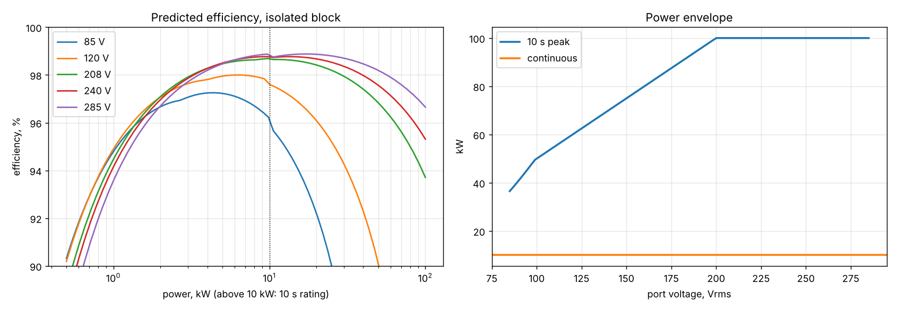
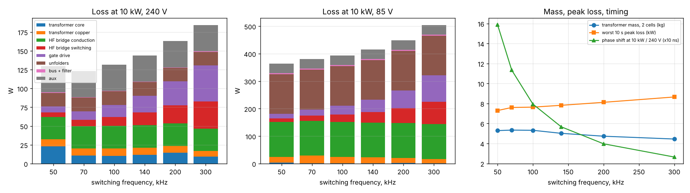

# 10 kW / 100 kW-peak bidirectional AC-AC dual active bridge block

Preliminary design, revision B. All numbers come from `tools/dab_design.py` and
`tools/dab_sim.py`; rerun them to regenerate the tables and plots. Nothing here
has been built or measured. Every price, volume and mass is a rough estimate
for comparing options against each other, not a quotation. Section 13 lists
what is estimated and what must be checked before hardware is committed.

## What changed from revision A

| | Rev A | Rev B |
|---|---|---|
| 10 s peak | 100 kW at any voltage (1176 A at 85 V) | 100 kW at 200 V and above, 500 A limit below |
| Semiconductor sizing | Large modules, junction peaked at 106 C | Sized by junction temperature at the end of the 10 s (115 C, target 125 C) |
| Switches | 24 half-bridge modules, about $46k | 144 TO-247 discretes, about $5.5k |
| Cells | 4 at 387 nH | 2 at 643 nH |
| Link capacitors | 80 uF per side | 40 uF per side |
| Role | Stand-alone unit | One block of a three-phase, parallelable system |

## 1. Requirement as now understood

| Item | Value |
|---|---|
| Port voltage | 85-285 Vrms on both ports, output equals input (1:1) |
| Continuous power | 10 kW across the whole range |
| 10 s peak | 100 kW from 200 V up; 500 A below that (60 kW at 120 V, 36 kW at 85 V) |
| Direction | Bidirectional, may reverse at any instant with no warning |
| Behaviour | Like an iron-core transformer of similar rating, including short surges |
| System use | One block per phase; blocks parallel for larger systems |
| Isolation | Preferred, not required; a non-isolated variant is costed in section 9 |
| Switching frequency | 50 kHz minimum |
| Compliance, telemetry | UL, FCC; voltage, current, temperature, power remotely readable |

Still assumed: the 10 s peak repeats no more often than once every 5 minutes,
and "power" means real power near unity power factor.

On a 208 V service a line-to-neutral block sees 120 V. There the surge is 60 kW,
six times continuous. Getting the full 100 kW at 120 V needs 833 A; section 4
says what that costs.



## 2. Architecture (unchanged)

```
 Port 1          unfolder 1      link 1        2 x DAB cells         link 2     unfolder 2        Port 2
 85-285 V  EMI   (60 Hz, SiC)   |v|, 40 uF   HB - 1:1 xfmr - HB    |v|, 40 uF  (60 Hz, SiC)  EMI  85-285 V
 o------[filter]--[ H-bridge ]----+--------[ cell 1,  cell 2 ]----------+----[ H-bridge ]--[filter]------o
                                 ===     (interleaved, one shed        ===
                                  |        at light load)               |
```

A line-frequency unfolder on each port presents the rectified line voltage to a
small film-capacitor link. Two dual-active-bridge cells run between the links
at unity conversion ratio. There is no DC link, no electrolytic capacitor and
no line-frequency energy storage. The link capacitors sit on the DC side of the
unfolders and both unfolders take one shared polarity command; that is what
lets out-of-phase current pass through the voltage zero crossing.

## 3. Inductance

DAB current capability is proportional to voltage and inversely proportional to
`f * L`. The inductance is set so that 500 A at 120 V needs a phase shift of
0.25 of a half period:

    f * L_total = 0.0225 ohm    ->   321 nH total at 70 kHz, 643 nH per cell with two cells

This is 3 times the revision A value and comfortably buildable with the
transformer leakage as the only inductor (583 nH leakage plus an estimated
60 nH of bus stray). Below 120 V the phase shift is allowed to rise to 0.35,
which gives 429 A (36 kW) at 85 V.

## 4. Semiconductors, sized thermally

The earlier module choice was driven by loss, not by any current rating, and
left about 45 K of unused junction headroom. This revision sizes each switch
position so the junction ends the 10 s event at or below 125 C, with on-resistance
evaluated at that temperature. The devices are rated 175 C; 125 C leaves
margin for the estimated thermal data.

One caution on what "thermal capacity" buys. Ten seconds is long compared with
a SiC die and package (well under one second), so the junction-to-case rise
reaches steady state during the event. The thermal mass that helps is the
heatsink: it is sized to rise 15 K during the event (5.1 kg of aluminium)
instead of being sized to remove 7 kW continuously.

1200 V devices are kept because the link has no bulk capacitor and line surges
reach the switches clamped only by the MOVs. GaN remains unsuitable for the
same reason.

HF bridge options at 70 kHz (unfolder fixed, whole-block cost shown):

| Cells | Per switch position | Peak Tj | Block cost | Note |
|---|---|---|---|---|
| 1 | one 1.33 mohm module leg | 122 C | $13.5k | 321 nH single transformer |
| 1 | one 2.6 mohm module leg | 231 C | - | fails |
| 2 | one 2.6 mohm module leg | 107 C | $13.4k | |
| 2 | one 1.33 mohm module leg | 90 C | $21.8k | rev A style |
| 1 | 9 x 16 mohm TO-247 | 124 C | $8.6k | cheapest that passes |
| **2** | **5 x 16 mohm TO-247** | **115 C** | **$9.6k** | **selected** |
| 2 | 4 x 16 mohm TO-247 | 138 C | $8.4k | passes only at a 150 C limit |

Two cells is chosen over the slightly cheaper single cell: it doubles the
leakage target, allows one cell to be shed at light load, interleaves the link
ripple, and leaves a working cell if one fails.

Unfolder options (line-frequency, 500 A):

| Per switch position | Peak Tj | Cost (8 positions) |
|---|---|---|
| 6 x 16 mohm TO-247 | 147 C | $1.8k |
| **8 x 16 mohm TO-247** | **113 C** | **$2.4k** |
| one 2.6 mohm module leg | 159 C | $3.4k |
| one 1.33 mohm module leg | 104 C | $7.6k |

Selected complement: 80 discretes in the HF bridges and 64 in the unfolders,
144 in total, about $5.5k. Paralleling five TO-247 parts in a 70 kHz
soft-switched bridge is established practice but needs a symmetric layout and
individual gate resistors. The unfolders switch at 60 Hz, so paralleling there
is easy.

The cost of thermal sizing is efficiency during the surge: 6-7.6 kW is
dissipated at the worst points, where revision A's oversized modules would have
lost about half that.

If the full 100 kW were required at 120 V, current rises to 833 A. Loss scales
with current squared, so the device count rises by roughly 2.8 times (about
$15k of switches) and the inductance target falls to about 385 nH per cell.

## 5. Switching frequency evaluation

Selected hardware, transformer re-optimised at each frequency:

| f | L per cell | Transformer (per cell) | Mass | Eff. 10 kW, 240 V | Eff. 10 kW, 85 V | Worst peak loss | Peak Tj |
|---|---|---|---|---|---|---|---|
| 50 kHz | 900 nH | 2x E100/60/28, 6 turns | 2.64 kg | 98.70 % | 96.36 % | 7.30 kW | 114 C |
| **70 kHz** | **643 nH** | **2x E100/60/28, 7 turns** | **2.67 kg** | **98.77 %** | **96.19 %** | **7.60 kW** | **115 C** |
| 100 kHz | 450 nH | 2x E100/60/28, 6 turns | 2.66 kg | 98.68 % | 96.06 % | 7.64 kW | 117 C |
| 140 kHz | 321 nH | 2x E100/60/28, 5 turns | 2.51 kg | 98.56 % | 95.84 % | 7.82 kW | 119 C |
| 200 kHz | 225 nH | 2x E100/60/28, 4 turns | 2.36 kg | 98.37 % | 95.51 % | 8.12 kW | 122 C |
| 300 kHz | 150 nH | 2x E100/60/28, 3 turns | 2.22 kg | 98.16 % | 94.96 % | 8.65 kW | 127 C |



The conclusion is the same as before, and flatter. The transformer is sized by
current and leakage, not flux, so it loses only 17 % of its mass between 50 and
300 kHz while efficiency and junction margin both get worse. 50 to 100 kHz is
effectively a tie. **70 kHz is retained**: both the fundamental and the 140 kHz
link ripple stay below the 150 kHz start of the FCC conducted band, and it sits
clear of the 50 kHz floor.

## 6. Transformer (one per cell, two per block)

Exhaustive search over 6 core shapes, 1-4 stacked sets, 1-12 turns,
interleaving, three litz strand sizes and copper build. Objective: mean
continuous loss across the voltage range plus 4 W per kg. Constraints: 55 K
steady rise with one cell carrying the full 10 kW, 30 K adiabatic rise in the
10 s peak, flux under 280 mT at +10 % line, and leakage on target with at least
a 1 mm reinforced barrier.

| Parameter | Value |
|---|---|
| Core | 2 stacked sets E100/60/28, MnZn power ferrite (N87 data used; N97/3C97 would be 15-25 % lower loss) |
| Turns | 7 : 7 |
| Winding arrangement | P/2 - S - P/2 |
| Conductor | Litz, 24.2 mm^2 copper per turn, 0.05 mm strands (about 12 300, as parallel bundles) |
| Primary-secondary barrier | 5.5 mm per interface, sets the leakage |
| Leakage inductance | 583 nH |
| Magnetising inductance | 72 uH, core gap about 1.3 mm (provides soft switching at all loads) |
| Peak flux | 139 mT at 285 V, 153 mT at +10 % |
| Mass | 2.67 kg (1.96 kg ferrite, 0.71 kg copper) |
| Loss, one cell carrying 10 kW | 58 W at 85 V, 30 W at 120 V, 19-24 W at 208-285 V |
| Steady temperature rise | 39 K (forced air) |
| Peak copper loss | 308 W per transformer, 11 K adiabatic rise in 10 s |

Flux is set by voltage, not current, so the 10x surge cannot saturate the core;
it only heats the copper. The 5.5 mm barrier is generous for reinforced
insulation and its thickness is the leakage trim; plan one prototype iteration.

## 7. Control, power reversal and transformer-like behaviour

Each cell uses single-phase-shift modulation. Twice per switching period:

    i_ref = (i_port1 + i_port2) / 2  +  Kp * e  +  Ki * integral(e)
    e     = (v_link1 - v_link2) - Zv * i          (Zv = programmable virtual impedance)
    D     = solve  D * (1 - |D|) = i_ref * 2 * f * L / (n_active * v_mean)

D is signed, and there is no direction flag or source/load designation. When
the far side starts pushing power back, the error and the feed-forward change
sign and D follows through zero within one 7 us sample. Averaging both port
currents in the feed-forward cancels the gyrator behaviour a DAB has on its
own, so the two links act like one capacitor behind an ideal transformer.

Simulated with one sample of delay, 40 uF per link, Zv = 0, both ports as
sources behind damped filter inductance, far-side source jumping at the line
crest so that steady-state power reverses:

| Event | Mismatch before | Worst mismatch after |
|---|---|---|
| 240 V, +10 kW to -10 kW, 1 cell | 0.1 V | 9.9 V (2.9 % of crest) |
| 85 V, +10 kW to -10 kW, 2 cells | 0.5 V | 20 V (17 %) |
| 240 V, +100 kW to -100 kW, 2 cells | 0.7 V | 43 V (12.6 %) |
| 120 V, +60 kW to -60 kW, 2 cells | 3.1 V | 31 V (18 %) |


The reversal itself moves the voltage by a few volts. The worst mismatch is a
sub-millisecond notch at the next zero crossing, where out-of-phase current is
carried through the unfolder flip. All cases are stable with 40 uF; 20 uF also
ran stable but with less margin.

The 40 uF links draw leading reactive current at no load: 4.3 A at 285 V,
3.6 A at 240 V, 1.8 A at 120 V per port. That is half the revision A figure.

**How it compares with an iron transformer under surge**

| | 10 kVA iron-core | This block |
|---|---|---|
| Series impedance | Fixed, typically 2-4 % | `Zv`, programmable; default 3 % at 10 kW |
| Voltage sag at 10x load | Roughly 20-40 % | Set by `Zv`; can be made non-linear to hold sag lower |
| Surge limit | Thermal, tens of times rated for cycles | 500 A hard limit for 10 s, then foldback to continuous |
| Fault current | 25-50x rated | 500 A: 12x rated at 240 V, 6x at 120 V |
| Inrush on energising | 8-12x rated | None |
| No-load loss | 50-100 W, constant | About 55 W, one cell shed |

The fault-current row matters for protection coordination. Breakers and fuses
downstream that rely on a transformer's high fault current to trip
instantaneously will see at most 500 A per block and must be chosen for that.

Other control functions: cell shedding (one cell above about 208 V at 10 kW and
below 2.5 kW everywhere), interleaving, magnetising-current flux balancing, and
a hard clamp on `i_ref` that turns the block into a current source during a
far-side fault. Controller: FPGA or a C2000-class MCU with 150 ps phase
resolution.

## 8. Predicted performance, isolated block at 70 kHz

| Vrms | 10 kW: cells / loss / efficiency | 2.5 kW efficiency | 10 s peak: power / loss / efficiency | Peak Tj (HF / unfolder) |
|---|---|---|---|---|
| 85 | 2 / 381 W / 96.19 % | 96.90 % | 36.5 kW / 6.2 kW / 83.1 % | 111 / 104 C |
| 120 | 2 / 223 W / 97.77 % | 97.44 % | 60 kW / 7.6 kW / 87.3 % | 115 / 113 C |
| 208 | 2 / 130 W / 98.70 % | 97.59 % | 100 kW / 6.3 kW / 93.7 % | 106 / 111 C |
| 240 | 1 / 123 W / 98.77 % | 97.51 % | 100 kW / 4.6 kW / 95.5 % | 99 / 102 C |
| 285 | 1 / 112 W / 98.88 % | 97.31 % | 100 kW / 3.2 kW / 96.8 % | 93 / 95 C |

Soft switching holds over the whole line cycle at every point. The closed-form
waveform model was checked against a time-stepped switched simulation
(60.12 kW simulated for 60 kW set; 304.5 A against 304.3 A rms).


## 9. Non-isolated variant

With a 1:1 ratio and no isolation there is nothing left to transform: the
ideal non-isolated "transformer" is a wire. What a power-electronic block can
still usefully do in that position is switch, limit and trim. The proposal is a
**bidirectional SiC AC switch in series with the line plus a smaller shunt
freewheel switch**, operated as an AC chopper at a duty near 1.

| | Isolated DAB block | Non-isolated block |
|---|---|---|
| Functions | Isolation, independent grounding, current limit, fast disconnect, power-flow control | Current limit, fast disconnect, soft connection, a few per cent of voltage trim |
| Switches in the current path | 8 | 2 |
| Discrete devices | 144 | 26 |
| Magnetics | Two 2.7 kg ferrite transformers | One small chopper inductor |
| Loss at 10 kW, 240 V | 123 W (98.77 %) | 38 W (99.6 %) |
| Loss at 10 kW, 85 V | 381 W | 90 W |
| Peak loss (500 A) | up to 7.6 kW | 1.3 kW |
| Estimated cost | $9.6k | $3.2k |
| Estimated volume | 42 L | 20 L |
| Estimated mass | 26 kg | 14 kg |

So dropping isolation saves about two thirds of the cost and half the volume
and mass, and cuts loss by a factor of three to five. What it gives up is the
ability to ground the two sides independently, to connect them differently in a
three-phase bank (for example delta on one side and wye on the other), and to
block common-mode voltage and DC between the sides. If none of those are needed
at a given site, the non-isolated block is the better engineering choice. The
two could share the control board, sensing, enclosure format and telemetry.

## 10. Size of one block and of a three-phase bank

Isolated block roll-up:

| Item | Cost | Volume | Mass |
|---|---|---|---|
| HF bridge switches (80) | $3,040 | 1.3 L | 0.6 kg |
| Unfolder switches (64) | $2,432 | 0.9 L | 0.3 kg |
| Gate drives | $600 | - | 0.3 kg |
| Transformers (2) | $900 | 3.1 L | 5.3 kg |
| Link capacitors | $56 | 0.3 L | 0.3 kg |
| Heatsink and fans | $141 | 6.4 L | 5.6 kg |
| EMI filters (2 ports) | $700 | 4.0 L | 6.0 kg |
| Contactors, fuses, surge | $500 | 1.6 L | 2.4 kg |
| Sensing, control, aux supply | $550 | 1.2 L | 0.8 kg |
| Busbars, PCBs, enclosure | $700 | - | 4.0 kg |
| **Total** | **$9.6k** | **18.8 L of parts, 42 L enclosed** | **26 kg** |

The enclosed volume assumes parts fill 45 % of the enclosure. 42 L is roughly a
440 x 480 x 200 mm chassis. For comparison, a 10 kVA encapsulated iron-core
transformer is in the region of 55-65 kg and 30-40 L (from memory, not checked
against a catalogue). The block is therefore about half the weight and similar
in volume. The heatsink and the two EMI filters, not the magnetics, set its
size; a tighter mechanical design could plausibly reach 30 L.

| Configuration | Continuous | 10 s peak | Isolated | Non-isolated |
|---|---|---|---|---|
| One block (single phase) | 10 kW | 100 kW | 42 L, 26 kg, $9.6k | 20 L, 14 kg, $3.2k |
| Three-phase bank (3 blocks) | 30 kW | 300 kW | 144 L, 83 kg, $29k | 70 L, 45 kg, $9.7k |
| Three-phase, 5 in parallel (15 blocks) | 150 kW | 1.5 MW | 720 L, 415 kg, $144k | 349 L, 227 kg, $49k |

Multi-block figures include 15 % volume and 8 % mass for a common frame.

**Three-phase connection.** Three blocks connected line-to-neutral serve
120/208 V directly. Line-to-line connection serves 208 V and 240 V delta. On
277/480 V the line-to-neutral voltage is 277 V, which is inside the range only
with 3 % headroom; if that service matters, the upper limit should be raised to
305 V. The devices and the transformer flux already allow it. Because each
block has no energy storage, the three pulsating phase powers sum to constant
power at the bank terminals, as in a transformer bank.

## 11. Paralleling: five blocks per phase

Five blocks per phase give 50 kW continuous and 500 kW for 10 s per phase, with
2500 A available at 200 V and above.

* **Sharing.** Transformers in parallel share in inverse proportion to their
  impedance. The blocks do the same through `Zv`: with equal `Zv` they share
  equally with no communication, and a slow trim over CAN removes residual
  sensor error. Without `Zv` the integral terms of paralleled blocks would
  fight, so it is mandatory in parallel operation. This has not been simulated
  yet and is the first thing to verify.
* **Block shedding.** At light load whole blocks go idle with their contactors
  closed and bridges off. A 150 kW bank at 10 % load runs two blocks per phase
  near their best efficiency instead of fifteen at their worst.
* **Redundancy.** Each block has its own contactors, fuses and protection. A
  failed block opens itself; four remaining blocks still give 40 kW continuous
  and 400 kW peak per phase.
* **Synchronisation.** A shared sync line staggers the switching phases across
  blocks, which cancels link ripple and lowers the combined conducted emission.
  A block that loses sync keeps running on its own clock.
* **Unfolder polarity.** Each block decides polarity from its own port
  voltages; all blocks see the same ports, so they agree. A mismatch lasting
  more than one sample would short two links together through the unfolders,
  so a hardware interlock on the shared sync line is needed.
* **Reactive current.** Link-capacitor current adds: 18 A leading per phase per
  side at 240 V with all five energised. Idle blocks can open their contactors
  to remove it.
* **Bus work.** 2500 A for 10 s per phase sets the collector bus and the
  upstream protection, not the blocks.
* **Physical.** 15 isolated blocks at 42 L are 630 L of chassis, 720 L framed:
  one 800 mm wide, 2 m tall cabinet if air paths allow, more comfortably two.
  Non-isolated, the same bank fits in half of one.

## 12. Compliance and instrumentation

**Safety (UL).** The governing standard depends on end use and should be fixed
with the test laboratory at the start: UL 1741 with IEEE 1547 if either port is
a utility interconnection with generation or storage behind it, otherwise
UL 1012 or UL 508-family industrial standards. Common provisions:

* Isolated variant: reinforced insulation port to port (transformer barrier,
  8 mm creepage and clearance across the boundary, reinforced-rated gate
  drivers, sensors and isolators); UL 1446 insulation system in the
  transformer. The non-isolated variant needs none of this but must then be
  evaluated as non-isolated equipment, with both ports treated as one circuit.
* UL 94 V-0 plastics, recognised film capacitors, listed fuses and contactors
  on both ports.
* MOVs with thermal disconnect on each port and an active clamp on each link,
  coordinated with the 1200 V device rating.
* Protection independent of firmware: desaturation or shunt-based short-circuit
  detection on every switch position (under 2 us), link over-voltage
  comparators, over-temperature cut-outs, watchdog opening the contactors.
* Both ports are treated as sources: link discharge after disconnection and
  warning labels on both sides.

**Emissions (FCC Part 15 Subpart B, Class A assumed; Class B if residential).**
Two-stage damped common-mode and differential-mode filter on each port,
laminated low-inductance bus, grounded electrostatic shield between transformer
windings, controlled gate resistance, shielded enclosure. Filters must not
saturate at 707 A peak.

**Instrumentation.**

| Quantity | Where | Method |
|---|---|---|
| Voltage | Both ports, both links | Isolated delta-sigma modulators |
| Current | Both ports (1 kA class), each cell's transformer primary | Closed-loop Hall or fluxgate on ports, Rogowski or CT per cell |
| Temperature | Each paralleled device group, 2 per transformer, heatsink, link capacitors, inlet and outlet air | NTC / PT1000 |
| Power | Per port | P, Q, S, power factor, direction, energy in each direction |
| State | Active cells, phase shift, `Zv`, share of bank current, limits, faults, event log with pre-trigger waveforms | Controller |

Published over isolated CAN FD (also used for bank sharing trim) and Ethernet
(Modbus TCP, or MQTT over TLS) at 10 Hz, faults pushed immediately. Remote
access is read-only by default. The CAN side can share a bus with the
battery-management code already in this repository.

## 13. Open items

1. **Device data.** The 16 mohm discrete and both module entries use estimated
   thermal resistance, output charge, temperature coefficient and fall time;
   the vendor datasheet site was not reachable from the design environment.
   Case-to-sink resistance for an isolated TO-247 mounting (0.45 K/W assumed)
   has a large effect on the device count and must be confirmed.
2. **Prices, volumes and masses** are my estimates. The ratios between options
   are more reliable than the absolute figures.
3. **Iron-transformer comparison figures** are from memory.
4. **Core dimensions** are catalogue-nominal from memory; ferrite loss uses two
   verified N87 datasheet points and two estimated ones.
5. **Leakage inductance** is from a one-dimensional formula, good to perhaps
   +/-20 %. Confirm by finite-element analysis and a prototype.
6. **Parallel operation and `Zv` droop** are designed but not simulated.
7. **Control model** is averaged with ideal sensing. Validate in a switched
   circuit simulator including dead time, device-to-device current sharing and
   cell mismatch.
8. **Reactive and non-linear loads** during the surge are only partly covered;
   the zero-crossing notch grows with out-of-phase current.
9. **Protection coordination** with the 500 A fault-current ceiling needs a
   site-level study.
10. Recommended first hardware step: one cell (both bridges and a transformer)
    tested DC-DC at 170 V and 400 V links, including a 10 s, 300 A thermal run,
    before the unfolders are added.
