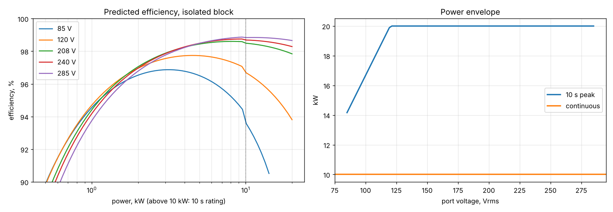

# 10 kW / 20 kW-peak variant: isolated and non-isolated blocks

Companion to `DESIGN.md` (the 100 kW-peak design). Numbers come from
`tools/dab_design_20kw.py`. Same caveats: a paper design, with estimated device
data, prices, volumes and masses. Architecture, control law, compliance and
telemetry are as in `DESIGN.md` and are not repeated here.

## 1. Specification

| Item | Value |
|---|---|
| Continuous | 10 kW, 85-285 Vrms (unchanged) |
| 10 s peak | 20 kW from 120 V up; 167 A below (14.2 kW at 85 V) |
| Isolated block | 1:1, bidirectional |
| Non-isolated block | 120 V to 277 V or 230 V, selectable, bidirectional, common neutral |
| Everything else | As before: SiC, 50 kHz minimum, UL, FCC, full telemetry, parallelable, three-phase use |

Assumption: I scaled the peak envelope the same way as before, as a current
limit. 167 A is 20 kW at 120 V, so a block on a 208Y/120 service delivers the
full 20 kW.

## 2. What a 2x surge changes

With a 10x surge the switches were sized by junction temperature at the end of
the 10 s event. With a 2x surge that limit is nowhere near binding: the
thermal-minimum design peaks at 123 C but would run at 90 % efficiency at
85 V. **Continuous efficiency at low line now sizes the switches**, and the
question becomes how much efficiency to buy.

Isolated block, 70 kHz:

| Tier | Devices | Cost | Efficiency at 10 kW: 85 / 120 / 240 V | Tj continuous / peak |
|---|---|---|---|---|
| Thermal minimum | 48 | $4.8k | 89.8 / 94.9 / 98.3 % | 81 / 123 C |
| **Balanced (selected)** | **96** | **$6.6k** | **94.2 / 97.0 / 98.8 %** | **69 / 90 C** |
| Matched to the 100 kW design | 168 | $9.3k | 96.0 / 97.8 / 98.9 % | 67 / 84 C |

Two things follow:

* Matching the low-line efficiency of the 100 kW-peak design costs almost the
  same as that design ($9.3k against $9.6k). In other words, the 100 kW surge
  capability was nearly free once the block was efficient at 85 V.
* If the block will mostly run at 208 V and above, the thermal-minimum tier is
  adequate there (98.3 % at 240 V) and saves another $1.8k.

I selected the balanced tier. Say if the installed voltage makes one of the
others the better choice.

## 3. Isolated block

| | 20 kW-peak | 100 kW-peak (for reference) |
|---|---|---|
| Cells | 1 | 2 |
| Series inductance | 683 nH (623 nH transformer leakage) | 643 nH per cell |
| HF bridge | 8 groups of 6 x 16 mohm TO-247 | 16 groups of 5 |
| Unfolders | 8 groups of 6 | 8 groups of 8 |
| Discrete devices | 96 | 144 |
| Transformers | one, 2.9 kg | two, 2.7 kg each |
| Link capacitors | 40 uF per side | 40 uF per side |
| Heatsink | 3.5 kg | 5.6 kg |
| Cost / volume / mass | $6.6k / 28 L / 17 kg | $9.6k / 42 L / 26 kg |

**Transformer.** Two stacked E100/60/28 ferrite sets, 8:8 turns, P/2 - S - P/2,
litz 27.5 mm^2 per turn (0.05 mm strands), 3.7 mm barrier per interface,
623 nH leakage, 60 uH magnetising inductance, 122 mT at 285 V. Loss with
10 kW: 62 W at 85 V, 32 W at 120 V, 19-22 W at 208-285 V; 42 K rise. Peak
copper loss 141 W, 4 K adiabatic rise. It is the same core as the 100 kW
design, because the transformer was always sized by 10 kW continuous, not by
the surge.

**Frequency.** Repeating the selection at each frequency:

| f | Devices | L | Transformer | Eff. 10 kW, 240 V | Block cost |
|---|---|---|---|---|---|
| 50 kHz | 88 | 956 nH | 6 turns, 2.65 kg | 98.65 % | $6.3k |
| **70 kHz** | **96** | **683 nH** | **8 turns, 2.88 kg** | **98.75 %** | **$6.6k** |
| 100 kHz | 96 | 478 nH | 6 turns, 2.67 kg | 98.66 % | $6.6k |
| 140 kHz | 104 | 342 nH | 5 turns, 2.52 kg | 98.56 % | $6.9k |
| 200 kHz | 112 | 239 nH | 4 turns, 2.37 kg | 98.39 % | $7.2k |
| 300 kHz | 128 | 159 nH | 3 turns, 2.23 kg | 98.08 % | $7.8k |

Same conclusion as before: 50-100 kHz is flat, higher costs devices and
efficiency for a small mass saving. 70 kHz is retained.

**Performance.**

| Vrms | 10 kW loss / efficiency | 2.5 kW efficiency | Peak power / loss / efficiency | Peak Tj |
|---|---|---|---|---|
| 85 | 582 W / 94.18 % | 96.8 % | 14.2 kW / 1.26 kW / 91.1 % | 90 C |
| 120 | 304 W / 96.96 % | - | 20 kW / 1.16 kW / 94.2 % | 89 C |
| 208 | 142 W / 98.58 % | - | 20 kW / 0.40 kW / 98.0 % | 83 C |
| 240 | 125 W / 98.75 % | - | 20 kW / 0.32 kW / 98.4 % | 82 C |
| 285 | 112 W / 98.88 % | - | 20 kW / 0.25 kW / 98.7 % | 81 C |

**What is lost with one cell.** There is no cell to shed at light load, no
interleaving of the link ripple, and no surviving cell if the bridge fails.
In a paralleled bank the redundancy comes from the other blocks. A two-cell
version with the same device count costs about $700 more.

**Not re-simulated.** The reversal and parallel-sharing simulations in
`DESIGN.md` were run for the 100 kW hardware. The control law and the
per-block inductance are essentially the same (683 nH against 643 nH per
cell), and the currents are lower, so I expect the same behaviour, but that is
an expectation and not a result.

## 4. Non-isolated block (120 V to 277 V or 230 V)

Same bidirectional AC chopper as `DESIGN.md` section 9, resized.

| | 20 kW-peak | 60 kW-peak (for reference) |
|---|---|---|
| Switch groups | 4 groups of 5 x 16 mohm TO-247 | 4 groups of 10 |
| Discrete devices | 20 | 40 |
| Inductor | 20 uH gapped ferrite, 2.6 kg | 20 uH soft-saturating powder core, 3.5 kg |
| Loss at 10 kW (277 V / 230 V) | 143 W / 148 W (98.6 % / 98.5 %) | 124 W / 116 W |
| Loss at 20 kW | 393 W (98.0 %) | - |
| Peak Tj | 102-107 C | 122 C |
| Cost / volume / mass | $3.0k / 21 L / 14 kg | $4.2k / 25 L / 18 kg |

The device count here is set by a 150 W loss ceiling at 10 kW, again not by
the surge.

The smaller surge fixes the weakest part of the earlier chopper. Peak inductor
current falls from 707 A to about 270 A, which a gapped ferrite can carry: on
the same two-stack E100/60/28 core as the transformer, 12 turns and a 13 mm
total gap give 20 uH at 306 mT. That gap is large, so it should be split into
several smaller gaps to limit fringing loss in the winding; the detailed
inductor design is still to do.

At 50 kHz the chopper needs 16 devices with about the same loss. The ratio is
still selected by duty cycle, and the low-side over-voltage crowbar is still
required.

## 5. Size and scaling

| Configuration | Continuous | 10 s peak | Isolated | Non-isolated |
|---|---|---|---|---|
| One block | 10 kW | 20 kW | 28 L, 17 kg, $6.6k | 21 L, 14 kg, $3.0k |
| Three-phase bank | 30 kW | 60 kW | 97 L, 56 kg, $20k | 74 L, 46 kg, $9.0k |
| Three-phase, 5 in parallel | 150 kW | 300 kW | 486 L, 279 kg, $99k | 369 L, 230 kg, $45k |

Against the 100 kW-peak isolated block, the 20 kW-peak one is about a third
smaller and lighter and about 30 % cheaper. The saving is modest because the
EMI filters, contactors, controller and enclosure do not shrink much, and
because the transformer does not shrink at all.

Fault current falls with the surge rating: 167 A per block, which is 4 times
rated current at 240 V and 2 times at 120 V. Downstream protection that needs
high fault current to trip quickly is harder to coordinate with this variant
than with the 100 kW one.

## 6. Open items specific to this variant

1. The tier choice in section 2 depends on where the block will actually
   operate; the 85 V corner drives a large share of the device count.
2. Reversal and parallel-sharing behaviour are expected to carry over but are
   not re-simulated for the single-cell hardware.
3. The chopper inductor is checked for flux only, not designed.
4. All open items in `DESIGN.md` section 13 apply.
