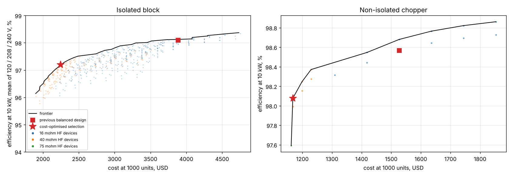

# Cost-optimised 10 kW / 20 kW-peak blocks, with 1000-unit cost

Companion to `DESIGN_20KW.md`. Numbers come from `tools/dab_cost.py`.

**What the cost figures are.** Bill of materials plus assembly and test, per
block. They exclude engineering, tooling, certification, warranty, freight and
margin, so they are a manufactured cost, not a selling price. The 40 mohm and
75 mohm SiC prices are anchored to distributor listings (about $7.03 at 90+
pieces and about $4.40 at 1000 respectively); the 16 mohm price and every other
line are my estimates. Treat the totals as good to perhaps +/-25 %; the
differences between options are more reliable than the totals.

## 1. What the search found

The search covered SiC die size (16, 40, 75 mohm), devices per group, 50 or
70 kHz, and two transformer recipes, keeping only designs that stay under
125 C in the surge and 110 C continuously. 612 isolated designs and 18 chopper
designs passed.

Three findings drive the result:

1. **Smaller die are much better value.** At 1000 units a 40 mohm part costs
   about $6.50 against about $26 for 16 mohm, so the same on-resistance costs
   about 40 % less, and spreading the heat over more packages also runs
   cooler. The 16 mohm parts used in the earlier designs were the wrong choice
   on cost. 75 mohm parts are no cheaper per milliohm and need too many in
   parallel.
2. **50 kHz beats 70 kHz on cost.** Every design on the cost frontier is at
   50 kHz. The larger allowed inductance lowers circulating current, and gate
   and switching loss fall. The price is that the fundamental sits exactly on
   the 50 kHz minimum, and its third harmonic lands at 150 kHz where the FCC
   conducted band starts, instead of the 140 kHz link ripple staying below it.
3. **The transformer is not where the money is.** It is about $127 at volume
   (about 6 % of the block). A cheaper winding recipe never made the frontier
   because the loss it adds costs more in switches than it saves in litz.

Devices per group were capped at 8 in the high-frequency bridge and 12 in the
line-frequency unfolder, as a layout limit.

## 2. Isolated block

| Design | 1k cost | Prototype cost | Devices | Efficiency at 10 kW: 85 / 120 / 240 V | Peak Tj |
|---|---|---|---|---|---|
| Previous balanced design (16 mohm, 70 kHz) | $3,885 | $6,894 | 96 | 94.2 / 97.0 / 98.8 % | 90 C |
| Same efficiency, re-optimised | $3,732 | $6,953 | 160 | 94.6 / 97.1 / 98.7 % | 85 C |
| Half a point less | $2,741 | $5,431 | 112 | 92.3 / 96.1 / 98.5 % | 102 C |
| **One point less (selected)** | **$2,245** | **$4,841** | **128** | **90.7 / 95.3 / 98.3 %** | **97 C** |
| Cheapest thermally valid | $1,898 | $4,203 | 88 | 86.7 / 93.4 / 97.7 % | 112 C |

"Half a point" and "one point" refer to the mean efficiency at 120, 208 and
240 V. The prototype column is higher than the $6.6k quoted in
`DESIGN_20KW.md` for the balanced design because this model adds assembly and
test.

**Selected design.** Giving up one point of typical efficiency cuts the
1000-unit cost by 42 %, from $3,885 to $2,245.

| Item | Selected |
|---|---|
| Switching frequency | 50 kHz |
| Cells | 1, series inductance 956 nH |
| HF bridge | 8 groups of 8 x 40 mohm TO-247-4 |
| Unfolders | 8 groups of 8 x 40 mohm TO-247-4 |
| Devices | 128, one part number |
| Transformer | 2 stacked E100/60/28 sets, 6:6 turns, 0.05 mm litz, 2.65 kg, 896 nH leakage |
| Heatsink | 4.3 kg |
| Loss at 10 kW | 934 W at 85 V, 469 W at 120 V, 200 W at 208 V, 173 W at 240 V, 156 W at 285 V |
| 20 kW surge | 2.1 kW loss, junction 97 C |

| Cost item | Prototype | 1000 units |
|---|---|---|
| SiC switches | $1,536 | $832 |
| Gate drives | $288 | $144 |
| Transformer | $279 | $127 |
| Heatsink and fans | $111 | $51 |
| Link capacitors | $56 | $28 |
| EMI filters (2 ports) | $500 | $220 |
| Contactors, fuses, surge | $350 | $160 |
| Sensing, control, aux supply | $550 | $190 |
| PCBs, busbars, enclosure | $550 | $230 |
| Assembly and test | $620 | $264 |
| **Total** | **$4,841** | **$2,245** |

**Why stop at one point.** One point at 10 kW is 100 W. At $0.12 per kWh and
half-time operation over ten years that is roughly $500 of energy, about what
the step from the balanced design saves in hardware at this point on the
curve. Going further to the cheapest valid design saves another $350 but adds
about 200 W at 120 V, which costs more in energy than it saves. If the blocks
run lightly loaded or mostly at 208 V and above, the cheapest design becomes
defensible; if they run hard at 120 V, half a point less is the better buy.

**What the cost-optimised design gives up.**

* Low-line efficiency. At 85 V and 10 kW it loses 934 W (90.7 %). That is
  inside the thermal limits, with a 72 C continuous junction, but it is the
  number to check against how often the block will really see that voltage.
* Emissions margin from the 70 kHz choice, as noted above.
* Simplicity of assembly: 128 through-hole devices to mount and clamp against
  96. Assembly is costed at $1.20 per device at volume.

## 3. Non-isolated block (120 V to 277 V or 230 V)

| Design | 1k cost | Prototype cost | Devices | Loss / efficiency at 10 kW | Loss at 20 kW | Peak Tj |
|---|---|---|---|---|---|---|
| Previous design (5 x 16 mohm, 70 kHz) | $1,527 | $3,316 | 20 | 143 W / 98.57 % | 393 W | 102 C |
| 8 x 40 mohm, 50 kHz | $1,229 | $2,970 | 32 | 163 W / 98.37 % | 509 W | 99 C |
| **6 x 40 mohm, 50 kHz (selected)** | **$1,168** | **$2,854** | **24** | **192 W / 98.08 %** | **666 W** | **112 C** |
| 8 x 75 mohm, 50 kHz | $1,162 | $2,842 | 32 | 241 W / 97.59 % | 926 W | 124 C |

Half a point of efficiency saves $359 per block, 24 %. Below the selected
design there is nothing left to gain: the switches are only $156 of the
$1,168.

| Cost item | Prototype | 1000 units |
|---|---|---|
| SiC switches | $288 | $156 |
| Gate drives | $72 | $36 |
| Inductor | $160 | $70 |
| Port capacitors, snubber | $60 | $25 |
| Low-side crowbar | $150 | $45 |
| Heatsink and fans | $84 | $37 |
| EMI filters (2 ports) | $380 | $160 |
| Contactors, fuses, surge | $350 | $130 |
| Sensing, control, aux supply | $550 | $190 |
| PCBs, busbars, enclosure | $400 | $180 |
| Assembly and test | $360 | $139 |
| **Total** | **$2,854** | **$1,168** |

## 4. Scaling at 1000-unit cost

| Configuration | Continuous / peak | Isolated | Non-isolated |
|---|---|---|---|
| One block | 10 / 20 kW | $2,245 | $1,168 |
| Three-phase bank | 30 / 60 kW | $6,736 | $3,503 |
| Three-phase, 5 in parallel | 150 / 300 kW | $33,679 | $17,517 |

That is about $225 per continuous kW isolated and about $117 non-isolated.

## 5. Where the remaining cost is

After this optimisation the switches are 37 % of the isolated block and 13 %
of the non-isolated one. The rest is filters, protection, control, mechanics
and assembly, about $1,150 per isolated block and about $975 per chopper,
which efficiency trading cannot touch. Further savings, not modelled, would
have to come from there:

* **Share per-bank items in a three-phase assembly**: one controller, one
  auxiliary supply, one enclosure and one communication interface for three
  blocks instead of three of each.
* **Size the EMI filters and contactors for the bank** instead of per block
  when blocks are paralleled.
* **Relax the 85 V full-power requirement.** If 10 kW were only required down
  to about 100 V, the low-line current falls 15 % and the loss by 28 %, which
  moves the whole frontier.
* **Surface-mount or top-cooled packages** in place of TO-247 would cut the
  assembly line, which is larger than the transformer.

## 6. Open items specific to this document

1. The 16 mohm volume price, and all non-semiconductor prices, are estimates;
   quotes at volume would move the totals.
2. Thermal data for the 40 and 75 mohm parts are estimates, as before.
3. Current sharing among eight paralleled devices at 50 kHz is assumed, not
   analysed.
4. Reversal and parallel-sharing simulations have not been re-run for this
   hardware (956 nH, 50 kHz, 10 us control period). The longer control period
   reduces stability margin somewhat, so this one should be re-run before the
   design is relied on.
