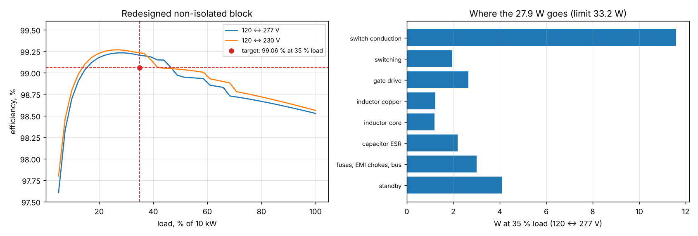

# Non-isolated block: current design (revision E)

Bidirectional AC chopper, 120 V to 277 V or 230 V, 10 kW continuous, 20 kW for
10 s, designed for at least 99.06 % efficiency at 35 % load, with no port
contactors. Numbers come from `tools/chopper_doe.py`. It is a paper design:
device data, resistances and standby power are estimates, and at this
efficiency level a few watts decide the result. Section 5 says how much each
assumption is worth. `CERTIFICATION.md` covers what the 99.06 % figure applies
to and the certification path.

## 1. What the target means

Transformer standards define efficiency as output over output plus losses, at
35 % of rated load:

    3.5 kW out, 99.06 %  ->  at most 33.2 W of total loss, including standby

The cost-optimised chopper from `DESIGN_COST.md` manages about 98.4 % at that
point, roughly 57 W. Half of that was a flat 25 W allowance for control and
auxiliaries, which was harmless at 10 kW and is fatal here.

## 2. What changed from the cost-optimised chopper

1. **Soft switching at light load.** The inductor is reduced to 16 uH so that
   below about 40 % load its ripple current is larger than the load current.
   The current then reverses every switching cycle and the switches turn on at
   zero voltage. The controller raises the frequency above 50 kHz as load
   falls (60 kHz at 35 % load, about 110 kHz at 10 %) to hold that condition
   with the least ripple, and returns to 50 kHz, hard-switched, above about
   half load. The frequency never goes below 50 kHz.
2. **Every milliohm is counted.** Fuses, both windings of both EMI chokes,
   busbars and capacitor ESR are in the model with explicit resistance
   targets.
3. **Standby is budgeted item by item** and held to 4.1 W: 2.5 W for
   controller, sensing and communications, 0.6 W for the gate supplies, 1.0 W
   of auxiliary-supply loss. Fans stay off below 80 W of dissipation.
4. **No port contactors.** A transformer has none, and here they did nothing
   that the fuses and crowbar do not. Removing them saves 1.4 W of coil power
   and about 0.5 mohm in each current path. The low-side over-voltage
   protection is duplicated instead: two crowbar devices, each with its own
   hardware trip.
5. **More silicon**: 10 devices per group instead of 6.

## 3. Selected design

| Item | Value |
|---|---|
| Topology | Bidirectional AC chopper, see `SCHEMATIC_NONISO.md` |
| Switches | 4 groups of 10 x 1200 V 40 mohm SiC (40 devices); each group is two sets of 5 with a driver each |
| Inductor L1 | 16 uH on 3 stacked E100/60/28 ferrite sets, 8 turns of 80 mm^2 litz, 11 mm total gap, 0.58 mohm, 4.6 kg |
| Switching frequency | 50 kHz minimum, raised automatically at light load |
| Standby | 4.1 W |
| Path resistance targets | 2.5 mohm total on the 120 V side, 5.5 mohm on the high side, 3 mohm ESR per capacitor bank |
| Protection | Fuse and MOV on each port, two independent crowbars on the 120 V side, desaturation detection on every driver, neutral-loss detection |

| | 120 V to 277 V | 120 V to 230 V |
|---|---|---|
| **Efficiency at 35 % load** | **99.21 %** (27.9 W, 60 kHz) | **99.23 %** (27.3 W, 50 kHz) |
| Efficiency at 100 % load | 98.53 % (149 W) | 98.56 % (146 W) |
| 20 kW for 10 s | 500 W, junction 91 C | 502 W, junction 90 C |

I designed to 99.20 % instead of just clearing 99.06 %, which leaves about 5 W
of margin. The cheapest design that clears the bare target is 8 x 40 mohm per
group at $1,174 (99.12 %), with about 2 W of margin.

Efficiency against load, 120 V to 277 V:

| Load | 10 % | 20 % | 35 % | 50 % | 75 % | 100 % |
|---|---|---|---|---|---|---|
| Efficiency | 98.71 % | 99.18 % | 99.21 % | 98.95 % | 98.70 % | 98.53 % |
| Loss | 13 W | 17 W | 28 W | 53 W | 99 W | 149 W |

The step down between 35 % and 50 % is where soft switching is lost.

## 4. Where the 27.9 W goes (35 % load, 120 V to 277 V)

| Item | 35 % load | 100 % load |
|---|---|---|
| Switch conduction | 11.6 W | 78.9 W |
| Standby | 4.1 W | 4.1 W |
| Fuses, EMI chokes, busbars | 3.0 W | 24.5 W |
| Gate drive | 2.7 W | 2.2 W |
| Capacitor ESR | 2.2 W | 7.4 W |
| Switching | 2.0 W | 19.8 W |
| Inductor copper | 1.2 W | 5.1 W |
| Inductor core | 1.2 W | 1.5 W |
| Fans | 0 | 6.0 W |
| **Total** | **27.9 W** | **149.5 W** |

## 5. How firm the result is

Each line changes one assumption and shows the 35 % efficiency that results:

| If this turns out worse | Efficiency at 35 % load |
|---|---|
| As designed | 99.21 % |
| Standby 3 W higher | 99.13 % |
| On-resistance 20 % higher | 99.14 % |
| Switching loss doubled | 99.15 % |
| Path resistance 50 % higher | 99.17 % |
| Inductor loss 50 % higher | 99.18 % |
| All five together | about 98.93 % |

The design survives any one of these and fails if all five go wrong at once.
99.06 % is achievable but has to be proven on hardware, with standby power and
the passive path as the items to watch.

## 6. Cost

| Item | Prototype | 1000 units |
|---|---|---|
| SiC switches | $480 | $260 |
| Gate drives | $144 | $72 |
| Inductor | $220 | $95 |
| Heatsink and fans | $84 | $37 |
| Port capacitors, snubber | $60 | $25 |
| Fuses, surge protection | $150 | $55 |
| Redundant low-side crowbar | $210 | $65 |
| EMI filters (2 ports) | $380 | $160 |
| Sensing, control, aux supply | $550 | $190 |
| PCBs, busbars, enclosure | $400 | $180 |
| Assembly and test | $400 | $158 |
| **Total** | **$3,078** | **$1,297** |

Manufactured cost (parts, assembly, test); not a selling price. That is $129
more than the cost-optimised chopper ($1,168) at volume, about 11 %, and $117
less than the same efficiency design with contactors. The model does not yet
price the lower-resistance chokes and low-power controller that the targets
imply; allow perhaps $50 more.

| Configuration | Continuous / peak | 1000-unit cost |
|---|---|---|
| One block | 10 / 20 kW | $1,297 |
| Three-phase bank | 30 / 60 kW | $3,891 |
| Three-phase, 5 in parallel | 150 / 300 kW | $19,455 |

A design using six 16 mohm devices per group reaches 99.29 % with 24 devices
for about $1,581, if fewer parts matter more than cost.

## 7. Behaviour that differs from a transformer

* **No output without control power.** The MOSFETs are normally off, so the
  block is dead until its auxiliary supply starts. The supply draws from
  either port.
* **Off is not isolated.** With the switches off, the output is still coupled
  to the input through capacitance. The upstream disconnect is the isolation
  means, as with a transformer.
* **Fault current is limited** to about 167 A on the 120 V side, twice rated
  current. Downstream protection must be chosen for that.
* **Emissions.** The switching frequency moves between 50 and about 110 kHz
  with load, so the EMI filter must cover that range.

## 8. Isolated block

Not redesigned. It has eight devices in the current path, a transformer and
two unfolders; its best 35 % point so far is well under 99 %, and I do not
expect it to reach 99.06 % without a different topology. Its documents
(`DESIGN.md`, `DESIGN_20KW.md`, `DESIGN_COST.md`) still show port contactors;
the same reasoning for removing them applies.

## 9. Open items

1. Regulatory applicability of the 99.06 % figure: see `CERTIFICATION.md`.
2. Replace estimated device data with datasheet values, especially output
   charge and turn-off energy, which set the soft-switching boundary.
3. Zero-voltage switching holds over 83 % of the line cycle at 277 V; near the
   voltage zero crossing the energy is too small. The model accounts for the
   residual loss but it has not been simulated at circuit level.
4. Variable-frequency control, zero-crossing commutation and current sharing
   among ten paralleled devices are not simulated.
5. The inductor's ripple-current loss uses an assumed AC resistance factor of
   3; with an 11 mm gap, fringing loss needs a proper design.
6. Crowbar and fuse coordination is not calculated.
