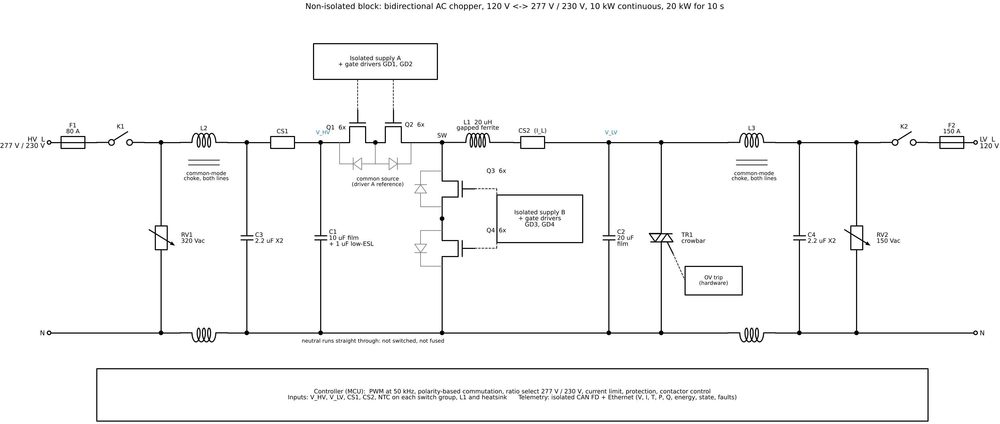

# Schematic: non-isolated single block

Bidirectional AC chopper, 120 V to 277 V or 230 V, 10 kW continuous, 20 kW for
10 s. This is the cost-optimised version from `DESIGN_COST.md` (50 kHz, six
40 mohm devices per switch group). It is a power-stage schematic at block
level: gate-drive, sensing and controller circuits are shown as blocks, and
component values are preliminary. Nothing here has been built or simulated at
circuit level.

A vector copy is at `img/schematic_noniso.svg`. Both are generated by
`tools/draw_noniso_schematic.py`.

## Parts

| Ref | Part | Value / rating (preliminary) | Purpose |
|---|---|---|---|
| Q1, Q2 | 6 x 1200 V 40 mohm SiC MOSFET, TO-247-4, each | Common-source pair | Series bidirectional switch |
| Q3, Q4 | 6 x 1200 V 40 mohm SiC MOSFET, TO-247-4, each | Common-source pair | Shunt (freewheel) bidirectional switch |
| L1 | Gapped ferrite inductor, 2 stacked E100/60/28, 12 turns | 20 uH, no saturation to 270 A | Chopper inductor, low-voltage side |
| C1 | Film, plus low-inductance capacitor at the switches | 10 uF + 1 uF, 630 Vac class | High-side switching-current bypass |
| C2 | Film | 20 uF, 300 Vac class | Low-side output filter |
| C3, C4 | X2 film | 2.2 uF | Differential-mode EMI |
| L2, L3 | Common-mode choke, nanocrystalline | Sized for 90 A / 170 A peak | Common-mode EMI; leakage gives differential inductance |
| RV1, RV2 | MOV with thermal disconnect | 320 Vac / 150 Vac | Surge clamp |
| TR1 | Triac or anti-parallel SCR pair | Rated to clear F1 | Low-side over-voltage crowbar |
| OV trip | Comparator and trigger, no firmware | Trips at about 150 V rms equivalent | Fires TR1 if 277 V appears on the 120 V side |
| F1, F2 | Time-delay fuse | 80 A / 150 A | Fault clearing; F1 is what TR1 blows |
| K1, K2 | Contactor | 277 Vac 90 A / 120 Vac 170 A | Galvanic disconnect of each port |
| CS1, CS2 | Isolated current sensor | 150 A / 300 A peak | Port current and inductor current |
| GD1-GD4 | Isolated gate driver with desaturation detection | -4 / +15 V | One per switch group |
| Supply A, B | Isolated DC-DC | About 2 W each | One per common-source pair |

Six parallel devices per group means 24 MOSFETs. Each has its own gate
resistor; each group has one driver and one temperature sensor.

Not drawn: gate resistors and Kelvin-source returns, the RC snubber and TVS
across each switch pair, capacitor discharge resistors, Y capacitors to
chassis, the auxiliary supply, and the voltage-sense dividers.

## How the switches are driven

Each bidirectional switch is two MOSFET groups back to back. In any half cycle
one group of each pair only needs to conduct, so it is held on, and the other
two groups switch as an ordinary synchronous buck leg with dead time.

| Line half cycle | Q1 | Q2 | Q3 | Q4 |
|---|---|---|---|---|
| Positive (L above N) | PWM, duty D | Held on | PWM, complement of Q1 | Held on |
| Negative (L below N) | Held on | PWM, duty D | Held on | PWM, complement of Q2 |

* **Ratio.** Low-side voltage is D times high-side voltage: D = 0.433 for
  277 V, 0.522 for 230 V. The same duty gives step-up in the other direction.
* **Direction.** Nothing changes with the direction of power flow; current
  simply reverses in L1.
* **Zero crossing.** The hand-over between the two rows is the delicate
  moment. The usual approach is to keep all four groups conducting in a narrow
  window around zero volts, where the voltage is too small to drive a harmful
  shoot-through current. This has not been simulated.
* **Two floating supplies are enough**, because the two MOSFET groups in each
  pair share a source. Supply A rides on the series pair's common source,
  which swings at 50 kHz; supply B rides on the shunt pair's.

## Protection built into the schematic

* **Series switch fails short.** The 120 V side would rise toward 277 V. The
  hardware over-voltage trip fires TR1, which shorts the low side and blows
  F1. The controller also opens K1 and K2. This path must work with the
  controller dead.
* **Over-current or short circuit.** Desaturation detection in each gate
  driver turns its group off within about 2 us; the controller then holds the
  shunt pair on to let the inductor current decay.
* **Surge.** RV1 and RV2 clamp; the 1200 V devices leave margin above the
  320 Vac MOV clamping level.
* **Neutral.** It is not switched or fused. Both systems therefore share one
  neutral and one ground reference at all times.

## Three-phase use

Three of these blocks, one per phase, with the three neutrals bonded, convert
208Y/120 to 480Y/277 or 400Y/230 in either direction. Both sides must be
four-wire wye.

## Open items

1. Fuse, contactor and MOV ratings need a coordination study; values shown are
   placeholders consistent with the currents.
2. TR1 must be rated for the let-through energy of F1, and F1 must be fast
   enough that the 120 V side does not exceed what connected equipment
   tolerates. This has not been calculated.
3. The inductor is checked for flux only (306 mT at 270 A with a 13 mm total
   gap, to be split into several gaps).
4. Zero-crossing commutation, filter damping and current sharing among six
   paralleled devices are not yet simulated.
